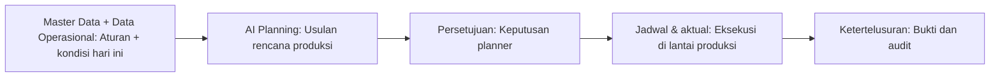
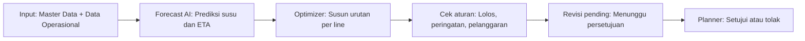
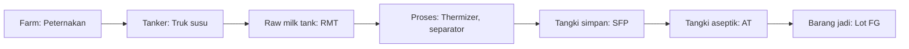
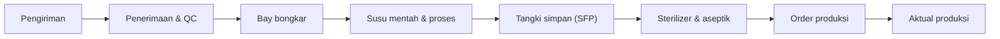

<!-- Generated by scripts/build_user_guide.js from src/content/userGuide.ts. Edit the source, then run `npm run guide:md`. -->

# Panduan Pengguna ORBIS

_AI Production Intelligence & Dairy Traceability_

ORBIS membantu pabrik susu menyusun rencana produksi harian dengan bantuan AI dan menelusuri setiap liter susu dari peternakan sampai produk jadi. Panduan ini dimulai dari pengaturan bahasa, lalu fokus pada dua kemampuan utama: **Perencanaan Produksi AI** dan **Ketertelusuran berbasis graf**.

> Seluruh angka di prototipe ini adalah **data demo sintetis** (skenario 30 Oktober). ID aset dan SKU mengikuti katalog resmi.

Panduan yang sama tersedia di dalam aplikasi: klik avatar di pojok kanan atas, lalu pilih **Panduan Pengguna** (`/guide`).

## Mulai cepat

1. **Atur bahasa**: Ganti ke Bahasa Indonesia ([1. Langkah pertama: atur bahasa](#1-langkah-pertama-atur-bahasa))
2. **Cek kondisi**: Dashboard dan alert ([9. Membaca Dashboard](#9-membaca-dashboard))
3. **Rencanakan dengan AI**: Forecast, konfigurasi, generate ([4. Perencanaan Produksi dengan AI](#4-perencanaan-produksi-dengan-ai))
4. **Setujui jadwal**: Human-in-the-loop ([5. Persetujuan dan jadwal produksi](#5-persetujuan-dan-jadwal-produksi))
5. **Telusuri susu**: Graf, mundur, maju ([6. Ketertelusuran dan penelusuran graf](#6-ketertelusuran-dan-penelusuran-graf))

## Daftar isi

- [1. Langkah pertama: atur bahasa](#1-langkah-pertama-atur-bahasa)
- [2. Mengenal tampilan](#2-mengenal-tampilan)
- [3. Konsep dasar: Master Data vs Data Operasional](#3-konsep-dasar-master-data-vs-data-operasional)
- [4. Perencanaan Produksi dengan AI](#4-perencanaan-produksi-dengan-ai) · _Fokus AI_
- [5. Persetujuan dan jadwal produksi](#5-persetujuan-dan-jadwal-produksi) · _Fokus AI_
- [6. Ketertelusuran dan penelusuran graf](#6-ketertelusuran-dan-penelusuran-graf) · _Fokus Ketertelusuran_
- [7. Skenario: investigasi mutu dan mock recall](#7-skenario-investigasi-mutu-dan-mock-recall) · _Fokus Ketertelusuran_
- [8. Data Operasional dan Master Data](#8-data-operasional-dan-master-data)
- [9. Membaca Dashboard](#9-membaca-dashboard)
- [10. Glosarium dan FAQ](#10-glosarium-dan-faq)

---

## 1. Langkah pertama: atur bahasa

_Aplikasi terbuka dalam Bahasa Inggris. Ganti ke Bahasa Indonesia sebelum mulai bekerja._

Saat pertama kali dibuka, ORBIS memakai bahasa **EN (English)**. Semua label menu, judul halaman, status, dan pesan aturan tersedia dalam dua bahasa: **EN** dan **ID**.

### Cara 1: dari header (paling cepat)

1. Lihat header di bagian atas layar, di sebelah kanan jam WIB.
2. Klik ikon **globe** (Language / Bahasa).
3. Pada panel kecil yang muncul, klik **ID**. Seluruh tampilan langsung berganti ke Bahasa Indonesia.

### Cara 2: dari halaman Pengaturan

1. Klik **avatar** (inisial nama) di pojok kanan atas.
2. Pilih **Settings / Pengaturan**.
3. Pada baris **Bahasa**, pilih **ID**.

> [!NOTE]
> **Pilihan bahasa tersimpan otomatis**
> Bahasa yang dipilih disimpan di browser perangkat ini (kunci `orbis-locale`), jadi tidak perlu diatur ulang setiap membuka aplikasi. Di perangkat atau browser lain, atur sekali lagi.

- Jam di header selalu memakai zona waktu pabrik **WIB (Asia/Jakarta)**, apa pun bahasanya.
- Format tanggal dan angka mengikuti bahasa: ID memakai titik sebagai pemisah ribuan (contoh 12.000 L).
- Kode teknis seperti `MILK_BALANCE`, `FL-01`, atau `AT-01` tidak diterjemahkan karena berasal dari katalog resmi pabrik.

---

## 2. Mengenal tampilan

_Sidebar berisi empat kelompok menu; header berisi pencarian, jam, peringatan, bahasa, dan akun._

| Kelompok sidebar | Modul | Dipakai untuk |
| --- | --- | --- |
| Pantau | Dashboard | Ringkasan kondisi pabrik hari ini |
| Operasional | Data Operasional | Alur fisik susu: pengiriman sampai aktual produksi |
| Operasional | Ketertelusuran Susu | Batch, transfer, graf relasi, telusur mundur/maju, audit log |
| Perencanaan | Perencanaan Produksi AI | Forecast, konfigurasi, generate plan, skenario, rekomendasi |
| Perencanaan | Jadwal Produksi | Jadwal aktif, kalender, alokasi, persetujuan, rencana vs aktual |
| Sistem | Master Data & Pengaturan | Katalog produk, aset, rute, eligibilitas line, aturan |

- **Tab modul** muncul di bawah judul halaman. Garis ungu menandai tab yang aktif.
- **Kotak pencarian** di header mencari nama modul dan tab. Ketik misalnya "telusur" lalu pilih hasilnya.
- **Ikon lonceng** menampilkan peringatan pabrik. Klik salah satu untuk langsung ke halaman penyebabnya.
- **Chip sumber data** di kanan atas judul menunjukkan asal data: skenario demo (data operasional) atau katalog resmi (master data).
- **Label ungu bertanda kilau** menandai keluaran AI. Bagian 4 menjelaskan cara membacanya.
- Sidebar bisa diciutkan menjadi ikon saja agar area kerja lebih lebar.

---

## 3. Konsep dasar: Master Data vs Data Operasional

_Master Data adalah aturan main pabrik; Data Operasional adalah apa yang terjadi hari ini._

Dua jenis data ini menjadi bahan baku AI. Memahami bedanya membuat rekomendasi AI lebih mudah dibaca.

|  | Master Data | Data Operasional |
| --- | --- | --- |
| Pertanyaan | Apa yang boleh dan mungkin dilakukan pabrik? | Apa yang sedang terjadi sekarang? |
| Sifat | Statis, jarang berubah | Dinamis, berubah setiap jam |
| Contoh | FL-01 boleh mengisi Chocolate; ganti rasa butuh 60 menit; CIP akhir produksi 60 menit | Tanker TRK-B02 diprediksi terlambat; level tangki susu mentah saat ini; ada 3 order produksi hari ini |
| Analogi | Resep dan denah dapur | Pesanan dan stok bahan hari ini |
| Siapa yang mengubah | Admin atau engineer, saat aturan pabrik berubah | Operator, QA, dan sistem pabrik sepanjang shift |

> [!TIP]
> **Aturan praktis**
> Sehari-hari Anda cukup bekerja di Dashboard, Data Operasional, Perencanaan Produksi AI, Jadwal Produksi, dan Ketertelusuran. Master Data hanya dibuka ketika aturan atau katalog pabrik berubah.

---

## 4. Perencanaan Produksi dengan AI

**Fokus AI** · AI memprediksi ketersediaan susu, menyusun urutan produksi per filling line, lalu setiap usulan diperiksa terhadap aturan pabrik.

Modul **Perencanaan Produksi AI** adalah inti ORBIS. AI tidak sekadar menampilkan angka: ia membaca kondisi hari ini, menyusun draf jadwal, memeriksa setiap aturan, dan menjelaskan alasannya. Keputusan akhir tetap di tangan **Production Planner**.

### Cara kerja AI dalam satu alur

### Dua jenis label AI

| Label | Artinya | Muncul di |
| --- | --- | --- |
| Forecast AI | Keluaran model prediksi, disertai tingkat keyakinan (confidence) atau rentang nilai | Forecasting, Dashboard |
| Optimizer | Penyusun jadwal otomatis: urutan order, changeover, dan CIP per filling line. Di prototipe ini masih berbasis aturan sebagai placeholder model AI | Generate plan, Skenario, Rekomendasi |

> [!WARNING]
> **Keyakinan AI bukan jaminan**
> Confidence adalah keluaran model. Hasil **cek aturan** (Lolos, Peringatan, Pelanggaran) adalah validasi pasti terhadap batasan pabrik. Selalu baca keduanya sebelum menyetujui rencana.

### Langkah A: Forecasting

1. Buka **Perencanaan Produksi AI**, tab **Forecasting**.
2. Baca empat kartu: **susu tersedia hari ini** (prediksi AI + confidence), **susu sudah release**, **susu menunggu lab/dalam perjalanan**, dan **prediksi besok** (dengan rentang).
3. Grafik penerimaan susu menampilkan riwayat harian, hari ini (ungu penuh), dan prediksi (garis putus-putus).
4. Tabel **kebutuhan susu** menghitung liter susu yang diperlukan rencana untuk produk plain dan flavoured. Kotak di bawahnya menunjukkan hasil cek `MILK_BALANCE`.
5. Tabel **prediksi ETA** menunjukkan truk yang diperkirakan terlambat datang atau terlambat hasil labnya.

### Langkah B: Konfigurasi

1. Buka tab **Konfigurasi**.
2. Ubah **jumlah pack** dan **prioritas** tiap order bila ada perubahan permintaan.
3. Atur **kecepatan filling line** (pack/jam), **utilisasi** (%) untuk memperhitungkan henti mesin, dan **jam mulai**.
4. Atur durasi **changeover**: ganti rasa (VARIANT), ganti ukuran (SIZE), ganti kertas (PAPER), serta durasi **CIP**.
5. Badge di samping judul menunjukkan apakah konfigurasi **berubah** dari revisi yang disetujui. Klik **Kembalikan ke yang disetujui** untuk membatalkan.
6. Klik **Pratinjau rencana** untuk lanjut ke Generate plan.

### Langkah C: Generate plan

1. Tab **Generate plan** langsung menampilkan **pratinjau timeline** per filling line: blok produksi, changeover, CIP, dan waktu tunggu.
2. Periksa tabel **hasil per order**: jam selesai, batas waktu, dan keterlambatan.
3. Periksa **daftar cek aturan** di sebelah kanan beserta ringkasan jumlah lolos, peringatan, dan pelanggaran.
4. Jika ada **pelanggaran**, tombol **Generate plan** terkunci. Kembali ke Konfigurasi dan sesuaikan.
5. Jika aman, klik **Generate plan**. ORBIS membuat revisi baru (contoh `PLAN-1030-v2`) berstatus **menunggu persetujuan**, lalu tampil tombol **Buka persetujuan**.

### Langkah D: Skenario (simulasi what-if)

Tab **Skenario** menjalankan beberapa alternatif sekaligus dengan aturan yang sama, tanpa mengubah rencana resmi. Klik satu baris untuk melihat timeline dan masalah utamanya.

| Skenario | Pertanyaan yang dijawab |
| --- | --- |
| Baseline rekomendasi | Bagaimana jadwal usulan dengan konfigurasi saat ini? |
| Bagi chocolate ke FL-01 dan FL-02 | Apakah order lebih cepat selesai jika dibagi dua line dan FL-02 menunggu AT-01 berganti produk? |
| Bagi chocolate tanpa menunggu | Apa yang terjadi jika FL-02 langsung mulai saat AT-01 masih berisi Full Cream? (biasanya melanggar AT_SAME_PRODUCT) |
| FL-02 breakdown | Jika FL-02 rusak dan semua order pindah ke FL-01, order mana yang terlambat? |
| Ganti rasa 60 menit | Berapa dampaknya jika changeover rasa memakai SOP standar 60 menit? |
| TRK-B01 ditolak | Cukupkah susu jika satu tanker ditolak lab (berkurang 13.000 L)? |

### Langkah E: Rekomendasi

- **Banner ungu** merangkum jadwal yang direkomendasikan per line, dengan tombol **Buka jadwal**.
- **Mengapa rencana ini**: jumlah order tepat waktu, kebutuhan susu vs ketersediaan, durasi ganti rasa, dan jam selesai.
- **Risiko**: hanya cek aturan yang berstatus peringatan atau pelanggaran.
- **Alternatif per peringatan**: untuk setiap pemicu (breakdown, kapasitas tangki, holding time, urutan, changeover, susu kurang) AI menampilkan usulan, dampaknya terhadap jam selesai dan jumlah order terlambat, serta tautan **Buka** ke halaman terkait.

### Membaca hasil cek aturan

| Status | Arti | Tindakan |
| --- | --- | --- |
| Lolos | Aturan terpenuhi | Tidak perlu tindakan |
| Peringatan | Rencana bisa jalan, tetapi ada risiko (contoh order terlambat, holding time hampir habis) | Tinjau dan putuskan; boleh disetujui |
| Pelanggaran | Melanggar batasan pabrik | Rencana tidak bisa di-generate atau disetujui; ubah konfigurasi |
| Tidak bisa dihitung | Data belum tersedia di skenario | Abaikan atau lengkapi data |

| Kode aturan | Yang diperiksa |
| --- | --- |
| MILK_BALANCE | Susu yang sudah lolos lab cukup untuk seluruh rencana |
| LINE_PRODUCT | Filling line boleh mengisi SKU tersebut (sesuai eligibilitas) |
| AT_SAME_PRODUCT | Dua line yang berbagi satu tangki aseptik tidak mengisi produk berbeda bersamaan |
| AT_SHARED_FLOW | Total tarikan dari tangki aseptik tidak melebihi batas alirnya |
| SIMULTANEOUS | Setelah ganti produk, tangki aseptik sempat CIP dan terisi ke level minimum |
| HOLDING | Susu di tangki simpan belum melewati batas waktu simpan |
| RECEIVING_GATE | Bongkar tanker baru dimulai setelah QA me-release hasil lab |
| PLAN | Setiap order selesai sebelum batas waktunya |

> [!TIP]
> **Prinsip human-in-the-loop**
> AI hanya mengusulkan. ORBIS tidak pernah mengaktifkan rencana, me-release mutu, atau menjalankan produksi tanpa persetujuan manusia. Setiap usulan dan keputusan tercatat di Audit Log.

Buka di aplikasi: Forecasting (`/ai-planning/forecasting`) · Konfigurasi (`/ai-planning/configuration`) · Generate plan (`/ai-planning/generate`) · Skenario (`/ai-planning/scenarios`) · Rekomendasi (`/ai-planning/recommendations`)

---

## 5. Persetujuan dan jadwal produksi

**Fokus AI** · Planner membandingkan revisi baru dengan rencana aktif, lalu menyetujui atau menolak. Rencana yang disetujui menjadi jadwal resmi.

### Menyetujui atau menolak revisi

1. Buka **Jadwal Produksi**, tab **Persetujuan** (atau klik **Buka persetujuan** setelah generate).
2. Bandingkan **timeline** revisi baru dan tabel **perbandingan** dengan rencana aktif: jam selesai, jumlah order terlambat, kebutuhan susu, durasi ganti rasa, dan utilisasi. Nilai yang berubah ditandai ungu.
3. Baca **masalah cek aturan** pada revisi tersebut.
4. Isi **catatan**: opsional untuk menyetujui, **wajib** untuk menolak.
5. Klik **Setujui rencana** atau **Tolak**. Tombol setujui terkunci jika revisi melanggar aturan.
6. Halaman hasil menampilkan siapa yang memutuskan, kapan, dan catatannya, dengan tautan ke jadwal dan audit log.

- Jika Anda generate lagi sebelum memutuskan, revisi lama otomatis berstatus **digantikan** (superseded).
- Saat revisi disetujui, rencana aktif sebelumnya juga menjadi **digantikan**.
- Tabel **riwayat revisi** di bagian bawah mencatat semua versi beserta statusnya.

### Setelah disetujui

| Tab | Isi |
| --- | --- |
| Jadwal rekomendasi | Rencana aktif per filling line: produksi, changeover, CIP |
| Kalender | Line, tangki aseptik, dan jendela maintenance sepanjang hari |
| Alokasi mesin | Order per filling line dan mesin hulu yang menyuplainya |
| Alokasi tangki | Tangki dan batch yang menyuplai setiap order, serta urutan tangki aseptik |
| Rencana vs aktual | Jumlah dan waktu rencana dibandingkan produksi yang tercatat |

Buka di aplikasi: Persetujuan (`/production-schedule/approval`) · Jadwal rekomendasi (`/production-schedule/recommended`) · Rencana vs aktual (`/production-schedule/planned-vs-actual`)

---

## 6. Ketertelusuran dan penelusuran graf

**Fokus Ketertelusuran** · Setiap perpindahan susu dicatat sebagai relasi dalam graf, sehingga asal dan tujuan sebuah batch bisa ditelusuri dalam hitungan detik.

ORBIS memodelkan perjalanan susu sebagai **graf berarah**. Setiap simpul (node) adalah peternakan atau batch di satu aset, dan setiap garis (edge) adalah satu transfer bervolume. Karena satu tanker bisa mengisi beberapa tangki dan satu tangki bisa menyuplai beberapa batch, graf ini menangkap relasi banyak-ke-banyak yang sulit dilacak dengan spreadsheet.

### Graf relasi

1. Buka **Ketertelusuran Susu**, tab **Graf relasi**. Kolom graf mengikuti kedalaman: farm di kiri, barang jadi di kanan.
2. **Klik sebuah node batch**: seluruh leluhur (asal) dan keturunannya (tujuan) disorot ungu; node lain meredup.
3. **Klik node farm**: semua tanker dari farm itu dan seluruh batch hilirnya disorot.
4. Klik **Detail batch** untuk membuka panel detail (volume, aset, status, mass balance).
5. Klik **Hapus pilihan** untuk kembali ke tampilan penuh.
6. Arahkan kursor ke garis untuk melihat ID transfer atau ID pengiriman.

### Telusur mundur (backward trace)

Dipakai saat ada **produk jadi yang bermasalah** dan Anda perlu tahu dari tanker dan farm mana susunya berasal.

1. Buka tab **Telusur mundur**. Secara bawaan terpilih lot `FG-1030-FL01-CH`.
2. Pilih batch target di kotak **Telusur mundur dari**.
3. Baca kartu ringkasan: jumlah **farm**, **tanker**, **batch**, dan **barang jadi** yang terlibat.
4. **Jalur** menampilkan tahapan dari farm sampai batch target.
5. Tabel batch menunjukkan **porsi kontribusi** setiap batch hulu terhadap target (dalam % dan liter), diurutkan per tahap.
6. Tabel **transfer** di bawahnya mencatat setiap perpindahan: waktu, asal, tujuan, volume, jenis, dan rute aset.

### Telusur maju (forward trace)

Dipakai saat ada **bahan baku yang bermasalah** (contoh hasil lab tanker meragukan) dan Anda perlu tahu produk jadi mana saja yang terdampak.

1. Buka tab **Telusur maju**. Secara bawaan terpilih `RT-A02-1030`.
2. Pilih batch sumber di kotak **Telusur maju dari** (tanker atau tangki).
3. Kartu **barang jadi** berwarna peringatan jika ada lot produk jadi yang tercapai dari sumber ini.
4. Kolom porsi menunjukkan berapa persen setiap batch hilir berasal dari sumber, sehingga cakupan dampak bisa dibatasi secara presisi.

### Tab pendukung

| Tab | Kegunaan |
| --- | --- |
| Batch | Semua batch dari tanker sampai barang jadi. Filter per tahap, cari ID, lihat status **mass balance** (volume masuk = keluar). Klik baris untuk detail. |
| Detail batch | Fakta batch, relasi genealogi, alokasi material, dan **verifikasi integritas** (hash event, referensi transaksi). Verifikasi ledger di prototipe ini disimulasikan. |
| Riwayat transfer | Setiap transfer beserta rutenya. Panah merah pada rute berarti koneksi antar aset tidak ada di master data rute. |
| Audit log | Siapa melakukan apa dan kapan: penerimaan, proses, serta pembuatan, persetujuan, dan penolakan rencana. Bisa difilter per kategori. |

Buka di aplikasi: Graf relasi (`/milk-traceability/graph`) · Telusur mundur (`/milk-traceability/backward`) · Telusur maju (`/milk-traceability/forward`) · Batch (`/milk-traceability/batches`) · Audit log (`/milk-traceability/audit-log`)

---

## 7. Skenario: investigasi mutu dan mock recall

**Fokus Ketertelusuran** · Contoh lengkap memakai graf untuk menemukan sumber masalah dan membatasi cakupan penarikan produk.

Situasi: QA menerima laporan rasa menyimpang pada lot Chocolate dari filling line FL-01. Tujuannya menemukan sumber susu, lalu menentukan produk lain yang berpotensi terdampak tanpa menarik seluruh produksi.

1. Di **Dashboard**, cek kartu **Ketertelusuran**: jumlah batch, transfer valid, mass balance, dan batch yang menunggu QA.
2. Buka **Graf relasi** dan klik lot `FG-1030-FL01-CH` untuk melihat seluruh garis keturunannya.
3. Buka **Telusur mundur** dari lot tersebut. Catat tanker dan farm asal beserta porsi kontribusinya.
4. Pilih tanker atau tangki yang dicurigai, lalu buka **Telusur maju** dari batch itu.
5. Klik **Simulasi 1-Click Mock Recall**. Seluruh batch hilir ditandai **QUARANTINE / RECALL**, dan banner menampilkan jumlah batch terpapar, volume terisolasi, dan SKU jadi yang terblokir.
6. Klik **Unduh Berita Acara Karantina (CSV)** untuk dokumentasi.
7. Klik **Reset Simulasi Karantina** untuk kembali ke status normal.

> [!WARNING]
> **Simulasi, bukan tindakan nyata**
> Mock recall hanya mengubah tampilan dan menghasilkan dokumen latihan. Keputusan karantina dan recall sebenarnya tetap diambil QA sesuai prosedur pabrik.

> [!TIP]
> **Hasil yang diharapkan**
> Hanya produk yang **terkonfirmasi terhubung** dengan sumber masalah yang ditarik. Produk lain tetap bisa dikirim, sehingga kerugian pabrik lebih kecil.

---

## 8. Data Operasional dan Master Data

_Data Operasional mengikuti jalur fisik susu; Master Data menyimpan katalog dan aturan resmi._

### Data Operasional (urutan jalur fisik)

| Tab | Yang dipantau |
| --- | --- |
| Pengiriman | Keberangkatan tanker, ETA, kedatangan, dan keterlambatan |
| Penerimaan & QC | Sampling, uji lab, dan release. Bongkar baru boleh setelah release (RECEIVING_GATE) |
| Bay bongkar | Ketersediaan bay, laju pompa, durasi bongkar, dan CIP antar tanker |
| Susu mentah & proses | Tangki susu mentah, thermizer, separator, tangki cream dan mixing |
| Tangki simpan (SFP) | Level, aliran, holding time, dan status CIP |
| Sterilizer & aseptik | Level tangki aseptik terhadap batas minimum untuk satu atau dua filler |
| Order produksi | Volume, kebutuhan susu, prioritas, batas waktu, line yang eligible |
| Aktual produksi | Output tercatat per order dan status filling line |

### Master Data & Pengaturan

| Tab | Isi |
| --- | --- |
| Produk & SKU | Liquid SKU, finished SKU, ukuran kemasan, market variant |
| Aset | Semua aset pabrik dengan parameter dan satuannya |
| Rute | Rute material yang diizinkan antar aset (dipakai validasi transfer) |
| Eligibilitas line | SKU dan ukuran kemasan yang boleh berjalan di setiap filling line (dipakai LINE_PRODUCT) |
| Aturan & asumsi | Katalog constraint, aturan changeover dan CIP, serta asumsi proyek |

---

## 9. Membaca Dashboard

_Titik awal setiap shift: susu, rencana aktif, peringatan, ketertelusuran, dan status aset dalam satu layar._

- **Empat KPI**: susu diterima (sudah release), susu tersedia (prediksi AI beserta sisa terhadap kebutuhan rencana), susu menunggu (lab pending dan dalam perjalanan), dan revisi rencana aktif atau yang menunggu persetujuan.
- **Neraca volume harian** 06:00 sampai 06:00.
- **Timeline rencana aktif** dengan garis waktu saat ini.
- **Peringatan**: klik untuk langsung ke halaman penyebab atau ke Rekomendasi AI.
- **Rencana vs aktual**: pack baik dibandingkan target sampai jam ini.
- **Ketertelusuran**: jumlah batch, transfer valid, mass balance, dan batch menunggu QA, dengan tautan ke graf.
- **Status aset**: level tangki dan kecepatan line. Kartu merah muda berarti aset sedang maintenance.

Buka di aplikasi: Dashboard (`/dashboard`)

---

## 10. Glosarium dan FAQ

_Istilah pabrik yang sering muncul dan jawaban atas pertanyaan umum._

| Istilah | Arti |
| --- | --- |
| CIP | Clean-in-place: pencucian otomatis pipa dan tangki tanpa membongkar mesin |
| Changeover | Waktu henti saat ganti rasa (VARIANT), ukuran (SIZE), atau kertas kemasan (PAPER) |
| RMT | Raw milk tank: tangki susu mentah setelah bongkar tanker |
| SFP / ST | Tangki simpan susu hasil proses sebelum sterilisasi |
| AT | Aseptic tank: tangki steril yang menyuplai filling line |
| FL-01 / FL-02 | Filling line: mesin pengisi kemasan |
| Holding time | Batas waktu susu boleh disimpan di tangki |
| Mass balance | Pengecekan bahwa volume masuk sama dengan volume keluar sebuah batch |
| Revisi rencana | Satu versi rencana produksi (contoh PLAN-1030-v2) dengan status disetujui, menunggu, ditolak, atau digantikan |
| Forward / backward trace | Penelusuran maju (ke produk jadi) atau mundur (ke asal susu) di graf |

**Apakah AI bisa langsung menjalankan produksi?**
Tidak. AI hanya mengusulkan rencana. Rencana baru aktif setelah planner menekan Setujui rencana.

**Mengapa tombol Generate plan tidak bisa diklik?**
Pratinjau melanggar setidaknya satu aturan pabrik. Lihat daftar cek aturan, ubah konfigurasi, lalu coba lagi.

**Apa beda Skenario dan Generate plan?**
Skenario hanya simulasi untuk membandingkan alternatif. Generate plan membuat revisi resmi yang menunggu persetujuan.

**Data saya hilang setelah halaman dimuat ulang?**
Prototipe menyimpan revisi rencana di memori browser. Memuat ulang halaman mengembalikan skenario ke kondisi awal. Hanya pilihan bahasa yang tersimpan.

**Apakah angka di aplikasi ini data nyata?**
Belum. Semua angka adalah data demo sintetis untuk skenario 30 Oktober.
